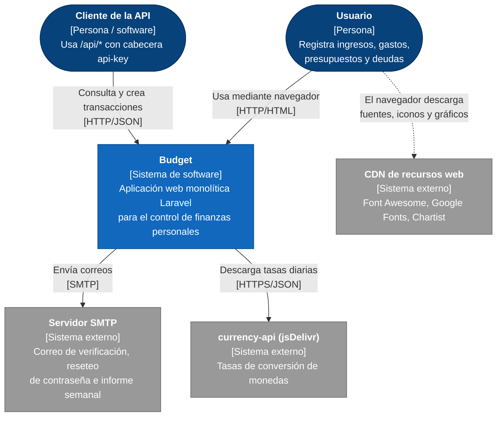
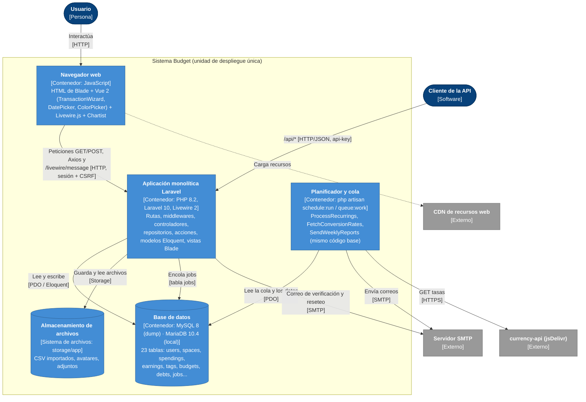
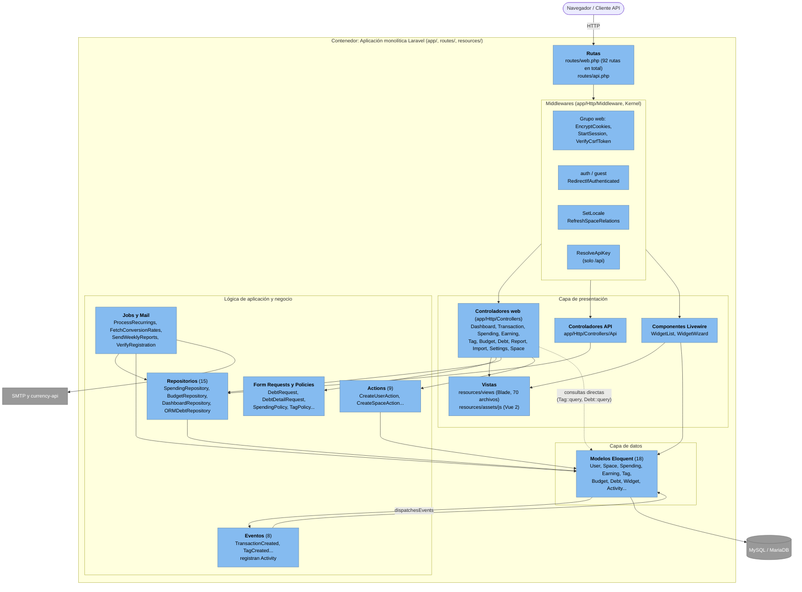

# Taller 14 — Instalación y análisis de una aplicación monolítica (Budget, Laravel)

**Estudiante:** Luisa Fernanda Velandia Salamanca · **Código:** U00179371
**Universidad Autónoma de Bucaramanga (UNAB)** · Arquitectura de Software · noviembre de 2026
**Docentes:** MSc. Fabian Suarez, MSc. Javier Pinzon, MSc. Feisar Moreno

## Resumen

Informe técnico de instalación y análisis de **Budget**, una aplicación de finanzas personales hecha con Laravel 10, Livewire 2 y Vite/Vue/Tailwind. Instalé la aplicación en Windows 11 (PHP 8.2 y MariaDB de XAMPP), la ejecuté localmente, probé sus funcionalidades con un navegador real, ejecuté su suite de pruebas (92 pruebas, 3 fallos preexistentes), analicé su arquitectura a partir del código y la modelé con C4 (niveles 1 a 3). Documenté los errores reales que aparecieron (SMTP en el registro, orden de rutas, base de pruebas sin migrar) y las consultas a la IA usadas para resolverlos.

- Aplicación original (no incluida aquí): <https://github.com/fmoreno4/butget_laravel> (autor: fmoreno4), commit analizado `c9d1f3e`.
- Este repositorio contiene solo mi documentación y evidencias.

## Índice del informe

Documento completo: [`docs/informe/Informe-Taller14-LuisaVelandia.pdf`](docs/informe/Informe-Taller14-LuisaVelandia.pdf) · [`.docx`](docs/informe/Informe-Taller14-LuisaVelandia.docx) · versión Markdown: [`docs/INFORME.md`](docs/INFORME.md)

1. [Introducción](docs/INFORME.md#1-introducción)
2. [Preparación del entorno](docs/INFORME.md#2-preparación-del-entorno)
3. [Proceso de instalación](docs/INFORME.md#3-proceso-de-instalación)
4. [Registro de errores y soluciones](docs/INFORME.md#4-registro-de-errores-y-soluciones) (incluye transparencia sobre el uso de IA)
5. [Ejecución del sistema](docs/INFORME.md#5-ejecución-del-sistema)
6. [Análisis arquitectónico](docs/INFORME.md#6-análisis-arquitectónico)
7. [Modelo C4](docs/INFORME.md#7-modelo-c4)
8. [Análisis crítico](docs/INFORME.md#8-análisis-crítico)

Otros archivos: [`docs/BITACORA.md`](docs/BITACORA.md) (bitácora cronológica), [`docs/evidencias/`](docs/evidencias) (capturas), [`docs/diagramas/`](docs/diagramas) (fuentes Mermaid y exportaciones PNG/SVG).

## Conclusión en pocas líneas

Budget es un **monolito Laravel** (un solo despliegue, una sola base de datos, vistas Blade con Vue y Livewire incrustados) con una separación por capas **parcial**: existe la convención controlador, repositorio, modelo, pero los repositorios dependen de la sesión HTTP, parte de la lógica vive en controladores y modelos, y la abstracción por interfaces solo se aplicó al módulo de deudas. El informe propone una capa de servicios, transacciones, un alcance por espacio desacoplado de HTTP y un monolito modular como evolución.

## Diagramas C4

### Nivel 1 — Contexto



### Nivel 2 — Contenedores



### Nivel 3 — Componentes



Versiones exportadas: [`nivel 1`](docs/diagramas/c4-nivel1-contexto.png), [`nivel 2`](docs/diagramas/c4-nivel2-contenedores.png), [`nivel 3`](docs/diagramas/c4-nivel3-componentes.png).

## Cómo reproducir la instalación

Requisitos: PHP 8.1 o superior con la extensión `calendar` (además de `pdo_mysql`, `mbstring`, `openssl`, `intl`, `zip`, `fileinfo`), Composer 2, Node.js con npm y MySQL o MariaDB. Comandos en Git Bash, uno por línea:

```bash
git clone https://github.com/fmoreno4/butget_laravel.git
cd butget_laravel
composer install
cp .env.example .env
php artisan key:generate
```

Crea una base de datos vacía (por ejemplo `budget_taller14`) y en el `.env` ajusta `DB_DATABASE`, `DB_USERNAME`, `DB_PASSWORD` y, para desarrollo sin correo real, agrega `MAIL_MAILER=log` (evita el error 530 de SMTP descrito en el informe). Luego:

```bash
php artisan migrate
npm install
npm run build
php artisan storage:link
php artisan serve --host=127.0.0.1 --port=8000
```

Abre <http://127.0.0.1:8000> y usa "Registrarse" para crear tu usuario. Para las pruebas, crea una base `<DB_DATABASE>_testing`, ejecuta `php artisan migrate --database=testing --force` y luego `php vendor/bin/phpunit`.
